  

  
  
  

I go into a business, find the work that eats its time and money, and ship the AI and automation
it runs on. Then I stay and operate it. Some engagements are paid projects; the best ones are
partnerships where I share in the results.

---

### How I work

1. **Diagnose:** sit close to the operation and write down where time and money leak
2. **Deploy:** build and integrate into the tools the team already uses (CRM, ad accounts, phones, invoicing)
3. **Operate:** keep it running, measure it, improve it, and package the reusable parts into product

---

### What's in production / in flight

🏨 **Verto**: the business system I build (CRM → ERP): ledger, VAT,
inventory, HR, POS. First deployment on-premises at a hospitality complex (pilot).

📈 **AI ads engine**: AI-orchestrated Meta ads for a marketing agency's clinic clients.
Reads performance across accounts today; spend changes go through a human-approved money wall.

📞 **Sofia**: voice AI agent (LiveKit Agents + Gemini Live + SIP) for call-center
first contact. Built and tested; pilot on hold.

🖥️ **Self-hosted inference**: two NVIDIA GB10 (DGX Spark) nodes running vLLM, a 27B model
with 128K context. Client data stays on our hardware, and inference has no per-token bill.

🚦 **[Fanar](https://fanar.zedigitaltech.workers.dev)**: Albanian road-alert PWA on Cloudflare's edge.

---

### Open source

🎙️ **[humanvad](https://github.com/ezekaj/humanvad)**: voice activity detection for real-time
voice agents. The hard part isn't the model, it's knowing when the human has actually finished.

⚡ **[elo-cli](https://github.com/ezekaj/elo-cli)**: terminal AI coding agent in Go (OpenCode fork
with Ollama, parallel subagents and a memory service).

🗺️ **[osm-business-audit](https://github.com/ezekaj/osm-business-audit)**: async Python toolkit that
discovers local businesses from OpenStreetMap and audits their web presence.

🧠 **[elo-agi](https://github.com/ezekaj/elo-agi)**: research project on neuroscience-inspired
cognitive architecture: 38 modules, runs fully offline.

---

### Stack

  

`vLLM` `LiveKit` `RAG` `Agents / tool use` `Meta Marketing API` `HubSpot`

---

### Background

🎓 42 Heilbronn (completed): peer-to-peer engineering school (C, C++, Unix, algorithms, networking)  
🎓 Universiteti Metropolitan Tirana (current)  
🌍 Albanian (native) · English (C2) · German (A2)

---

**Open to:** forward-deployed engagements, automation projects and partnerships with agencies
and businesses that want AI running in their operations, not just in a demo.

📫 **elvizekaj@zedigital.tech** · [zedigital.tech](https://zedigital.tech)

---

<picture>
  <source media="(prefers-color-scheme: dark)" srcset="https://raw.githubusercontent.com/ezekaj/ezekaj/output/github-snake-dark.svg">
  <source media="(prefers-color-scheme: light)" srcset="https://raw.githubusercontent.com/ezekaj/ezekaj/output/github-snake.svg">
  
</picture>
